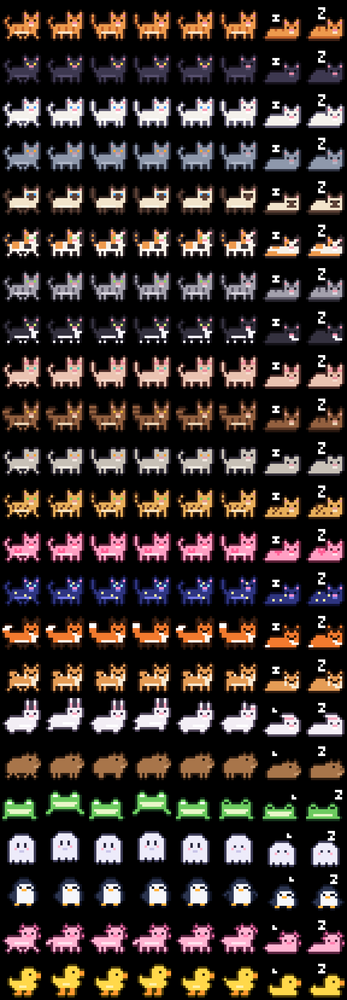

# Pixel Island

Пиксельные питомцы на Dynamic Island. 14 пород котиков, 9 друзей (лиса, сиба,
зайка, капибара, лягушка, призрак, пингвин, аксолотль, утёнок) и режим пары:
твой питомец и питомец твоей половинки ходят навстречу друг другу, а между ними
появляется сердечко.



## Что умеет

- **Островок:** питомец гуляет слева, питомец пары (или таймер фокуса) справа.
- **Развёрнутый вид** (зажми островок): прогулка вдвоём, кнопки «Погладить»,
  «Спать», «Стоп».
- **Экран блокировки:** сценка с обоими питомцами и счётчик «вместе N дней».
- **Пара без сервера:** обмениваетесь текстовым кодом `PI1.…` через любой мессенджер.
- **Фокус:** 15/25/45/60 минут. Питомец спит, пока ты работаешь, таймер виден
  на островке, в конце приходит уведомление.
- **Команды:** действие «Запустить Pixel Island» для автоматизаций.

## Установка

1. Скачай `PixelIsland.ipa`:
   https://github.com/xantarose/Pixel-Island/releases/download/latest/PixelIsland.ipa
2. Открой в ESign, подпиши своим сертификатом, установи.
3. Открой приложение → «Выпустить на островок».

Если питомца не видно: Настройки → Pixel Island → «Живые активности» должны быть включены.

## Как это устроено

| Папка | Что внутри |
|---|---|
| `App/` | Приложение: экраны, модель, запуск Live Activity, код пары |
| `Widget/` | Расширение с Live Activity (островок и экран блокировки) |
| `Shared/` | Общий код: спрайты, анимация, модель состояния, кнопки-интенты |
| `tools/sprites/` | Генератор пиксель-арта на Python, превью и иконка |
| `project.yml` | Описание Xcode-проекта для XcodeGen |
| `.github/workflows/build.yml` | Сборка `.ipa` на macOS-раннере GitHub |

### Анимация на островке

Пока питомец на островке, код приложения не выполняется: iOS просто рисует
сохранённую картинку. Покадровая анимация сделана через приватный эффект
`_ClockHandRotationEffect` (им Apple крутит стрелки в виджете часов):

1. Все кадры сложены стопкой.
2. Каждый кадр закрыт маской: кусочком огромного кольца, центр которого далеко внизу.
3. Кольцо поворачивается системными часами, кусочки по очереди проходят
   через окошко, и в каждый момент виден ровно один кадр.

Обход ограничения iOS 26.1+ взят из [ClockHandKit](https://github.com/giljihun/ClockHandKit)
(MIT, см. `Shared/Animation/ClockHandRotation.swift`). Это приватный API:
в App Store с ним не пустят, а будущая iOS может его сломать. Тогда питомец
просто будет стоять на месте, без падений.

### Ограничения iOS

- Live Activity живёт до 8 часов. Приложение само перезапускает питомца,
  когда ты его открываешь. Можно настроить автоматизацию в «Командах».
- Push-сервера нет, поэтому пара синхронизируется кодом, а не в реальном времени.

## Сборка вручную (нужен Mac)

```sh
brew install xcodegen
xcodegen generate
open PixelIsland.xcodeproj
```

Спрайты правятся в `tools/sprites/generate.py`, после этого:

```sh
python3 tools/sprites/generate.py   # Swift-данные + preview.png
python3 tools/sprites/make_icon.py  # иконка приложения
```
